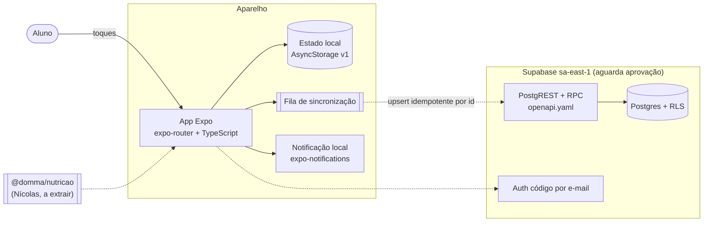
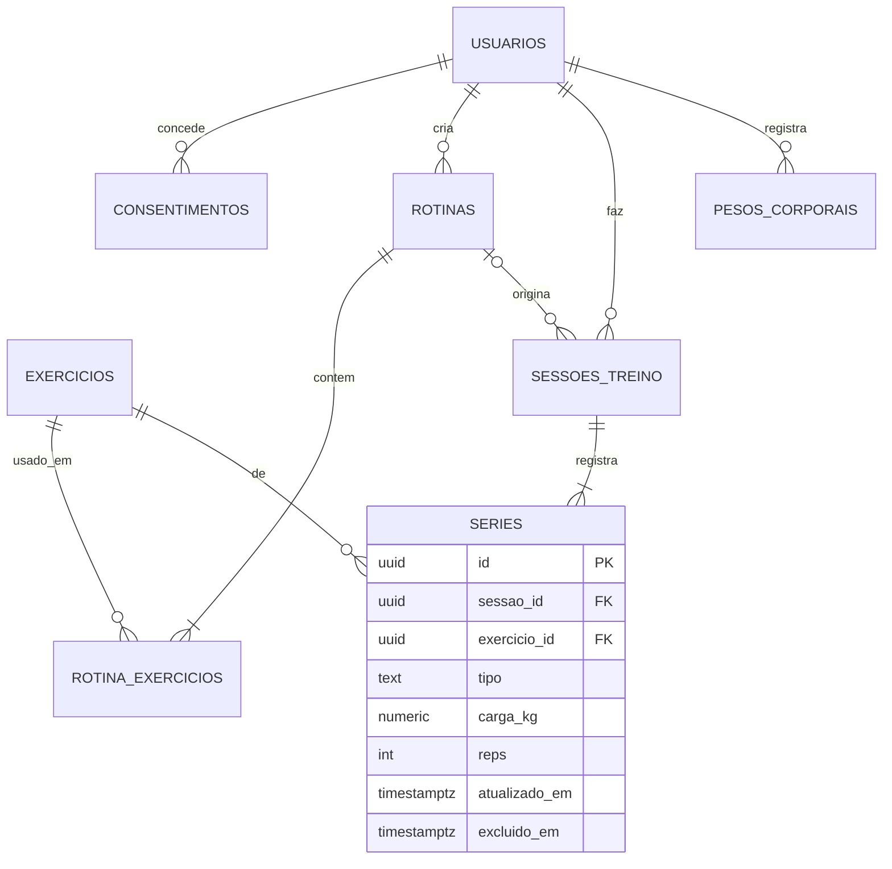
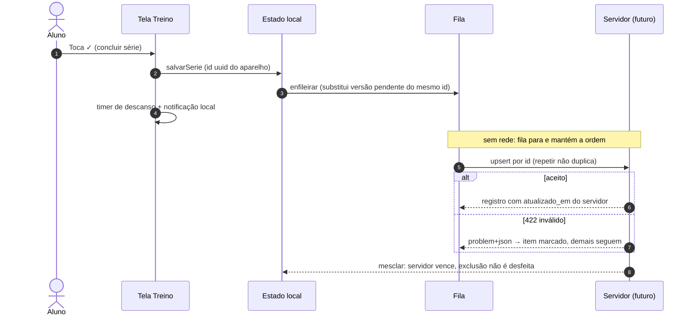
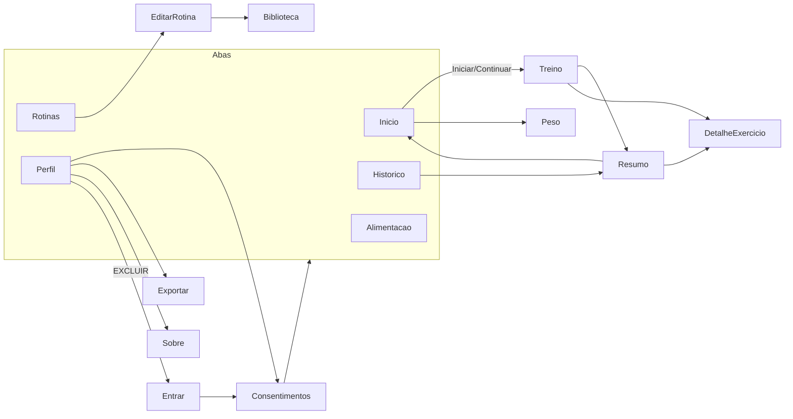

# Diagramas — app-academia (provisório) · 01/11/2026
Nomes iguais aos do código e do `GLOSSARIO.md`. Arquivos `.mmd` ao lado para renderizar.

## Contêineres (C4 em flowchart)

## Modelo de dados (ER)

## Sequência: registrar série offline e sincronizar (L2)

## Navegação

